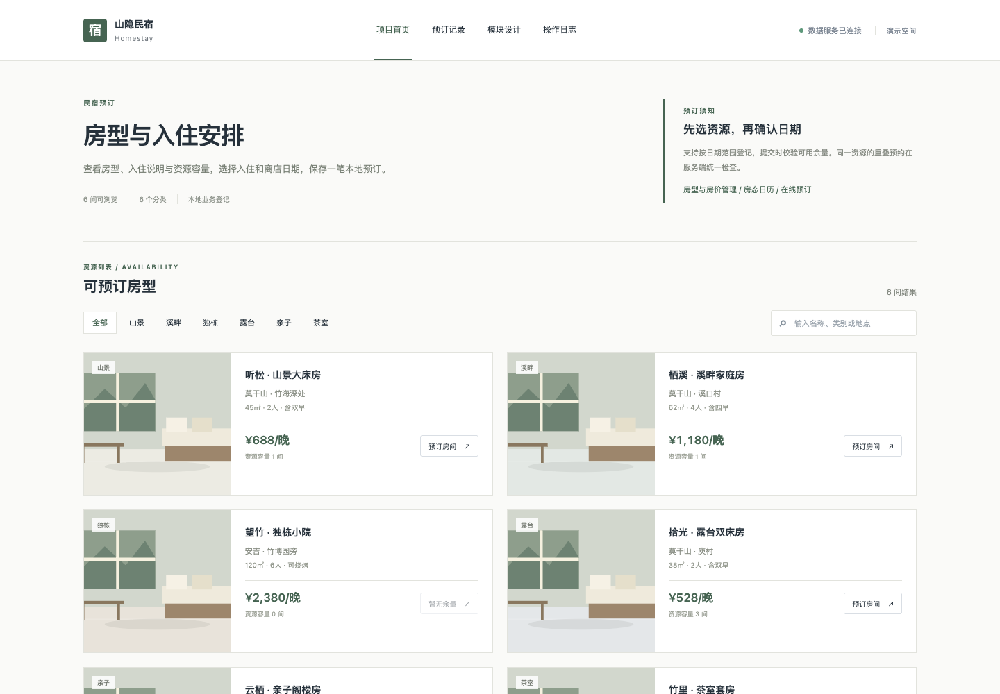

# 基于 Vue+SpringBoot 的小型民宿预订管理系统的设计与实现

## 技术栈

- 当前演示：Vue 3、Python、SQLite。
- 选题方案：Vue 3、Spring Boot、SQLite（部分技术尚未接入）。

## 项目功能

支持可预订房型浏览、分类筛选、关键词搜索和预订房间，登记数据保存在本地数据库。

完整方案规划包括：房型与房价管理、房态日历、在线预订、入住登记、续住与退房、渠道对账、住客档案、收益报表。部分功能尚待开发。

## 运行方式

在项目目录运行 `python3 backend/server.py`，然后访问 http://127.0.0.1:8000。

## 页面展示

## 微信联系

如果需要毕业设计，请扫描下方微信二维码联系。

